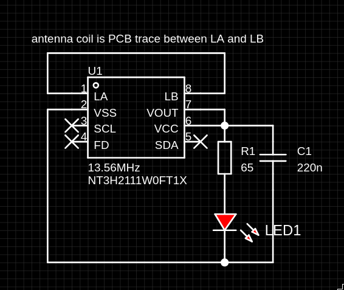
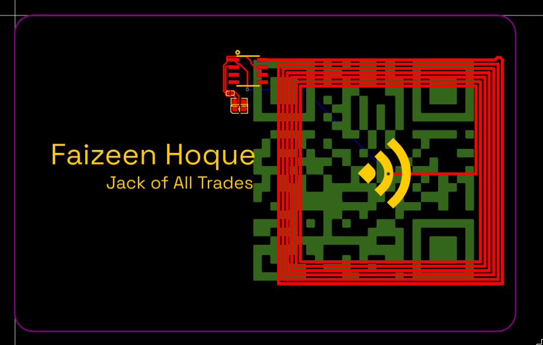
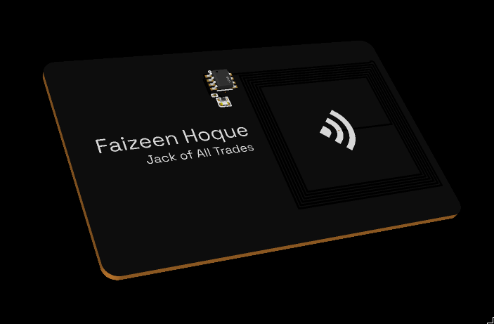

# NFC Business Card

A compact PCB business card that shares contact information through NFC and
lights a red LED from the phone's NFC field with no battery required. A QR code is
also included as a non-NFC fallback.

> **Status:** PCB design complete; manufacturing and hardware validation
> pending.

## Features

- NXP NT3H2111 NFC tag IC
- Passive 13.56 MHz PCB antenna
- Red field-powered indicator LED
- QR code for direct access without NFC
- EasyEDA project and production files included

## Design

The circuit is built around the **NT3H2111W0FT1X**. The LED is powered by the
NFC field and is current-limited with a **330 Ω** resistor. A **220 nF**
capacitor is included in the NFC circuit. The antenna is implemented as a
spiral trace around the edge of the card and was generated and tuned in
EasyEDA to fit the board outline.

### Schematic

### PCB and antenna layout

### 3D renders

## Bill of materials

The following table is based on [`Production/BOM.csv`](Production/BOM.csv).
Supplier and stock information reflects the export at the time of design.

| Qty. | Ref. | Description | Value | Manufacturer part | Supplier part |
|---:|:---|:---|:---|:---|:---|
| 1 | C1 | 0603 ceramic capacitor | 220 nF | TCC0603X7R224K500CT | LCSC C344195 |
| 1 | LED1 | 0603 red LED | Red | APTD1608LSURCK | LCSC C5342734 |
| 1 | R1 | 0603 resistor | 330 Ω | 0603WAF3300T5E | LCSC C23138 |
| 1 | U1 | SO-8 NFC tag IC | 13.56 MHz | NT3H2111W0FT1X | LCSC C2654859 |

The design uses four unique components and a total assembly quantity of four
parts per card.

## Repository contents

| Path | Description |
|:---|:---|
| [`design.epro2`](design.epro2) | EasyEDA project |
| [`Production/BOM.csv`](Production/BOM.csv) | Component bill of materials |
| [`Production/PickAndPlace.csv`](Production/PickAndPlace.csv) | Pick-and-place data |
| [`Production/Gerber.zip`](Production/Gerber.zip) | Gerber manufacturing files |
| [`images/`](images/) | Schematic, layout, and render images |

